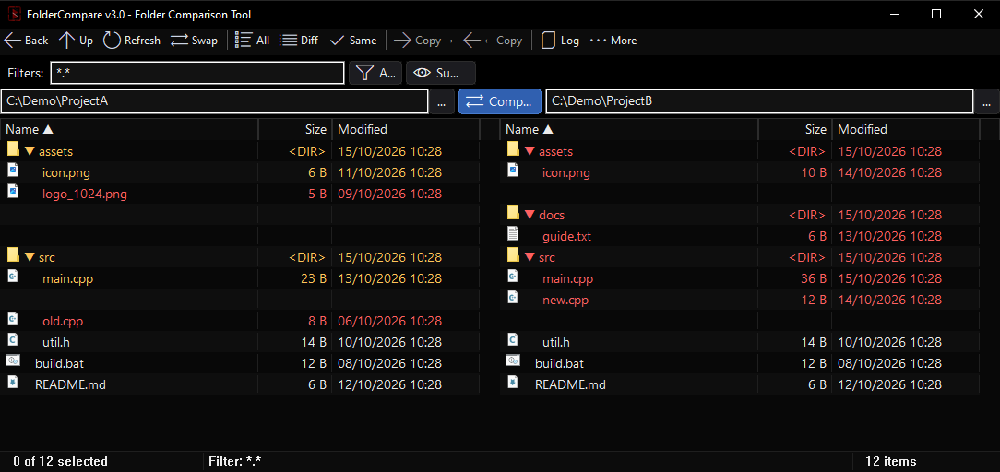

# FolderCompare

A lightweight, dark-themed folder comparison tool for Windows, written in C++ (Win32 API, no external DLLs).



## Features

- Side-by-side tree comparison of two folders (same / different / left only / right only)
- Filters with include / exclude patterns (e.g. `*.cpp;*.h`, `-*.ini*`)
- Expand / collapse tree, view modes (All, Differences, Same)
- Copy left → right / right → left, delete to Recycle Bin
- Drag & drop folders onto either side
- Copy auto-creates missing parent folders on the target side (like Beyond Compare)
- Pasting a path that does not exist asks whether to create it
- Double-click a folder to expand/collapse; right-click → *Open Folder* (or Enter) to compare inside it on both sides
- Sessions, comparison rules, keyboard shortcuts (F5 refresh, F6 copy, F7 copy back, Ctrl+F find)

### Image & file tools (right-click menu)

- **Resize PNG** — overwrites the original file in place (via a temp file, so a failure never damages the original)
  - Scale: ×0.5, ×2, ×3, ×4
  - Longest side: 512, 1K (1024), 2K (2048), 4K (4096)
  - Aspect ratio and transparency are preserved; works on multi-selection with a progress window
- **Rename...** — a floating tool window (3ds Max style) that stays open between renames
  - Base Name, Prefix, Suffix, Remove First / Last N characters, Numbered (base number + step)
  - Live preview; select other files in the main window and click Rename again
  - Extension is kept; files whose target name already exists are skipped

> Note: very large images are limited by GDI+ (output up to ~2 GB of pixels, i.e. roughly 22k × 22k).

## Build

Requires [MSYS2](https://www.msys2.org) with the UCRT64 toolchain (`g++`, `windres`).

```bat
build.bat
```

or manually:

```sh
windres FolderCompare.rc -O coff -o FolderCompare.res
g++ FolderCompare.cpp FolderCompare.res -o FolderCompare.exe -mwindows \
    -lcomctl32 -lshell32 -lole32 -lgdiplus -ldwmapi -luxtheme \
    -std=c++17 -O2 -static-libgcc -static-libstdc++ -static
```

## Configuration

Settings (last paths, column widths, filter) are stored in `FolderCompare.ini` next to the executable.

## Author & License

Copyright (c) 2026 [bencgn](https://github.com/bencgn). Released under the [MIT License](LICENSE).
